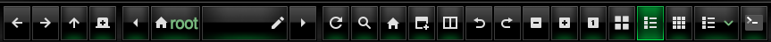
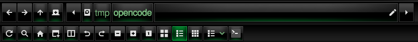

# Thunar two-row toolbar

A small patch for **Thunar 4.20** that splits the toolbar into **two rows**, so every toolbar button stays reachable on narrow screens (phones, netbooks, tiled windows), and makes the *"you are using the root account"* warning bar optional.

| Upstream (one row, last buttons clipped) | Patched (two rows) |
|---|---|
|  |  |

## Why

Thunar's toolbar is a `GtkToolbar`. When the window is too narrow it does **not** wrap — the last items are simply clipped or pushed into an overflow menu. With all toolbar items enabled on a small display, half of them become unreachable. There is no hidden setting for this; the only fix is to change the widget layout.

## What the patch does

Only `thunar/thunar-window.c` is touched.

1. **Two rows** — the location toolbar is packed into a vertical `GtkBox` together with a second `GtkToolbar`. Every item that comes *after* the **Location Bar** item is moved to the second row:
   - row 1: back, forward, up, new tab, full-width path bar (plus the path bar's own edit button)
   - row 2: reload, search, home, new window, split view, undo/redo, zoom, the three view modes, view switcher and all custom actions
2. **Toolbar editor keeps working** — *View → Configure Toolbar* and the icon-theme refresh temporarily merge the rows back into one toolbar, then split again, so item order and visibility are preserved and still saved correctly.
3. **Root warning bar removed** — the `GtkInfoBar` with *"Warning: you are using the root account. You may harm your system."* is only shown when the environment variable `THUNAR_SHOW_ROOT_WARNING=1` is set:
   ```bash
   THUNAR_SHOW_ROOT_WARNING=1 thunar
   ```

The split point is the item whose internal id is `location-bar`. To move it, edit `thunar_window_location_toolbar_split_rows()` in the patch.

## Requirements

- Thunar **4.20.x** (tested with 4.20.2 on Parrot 7 / Debian 13, aarch64)
- Build dependencies:

```bash
sudo apt install build-essential libgtk-3-dev libxfce4ui-2-dev libxfce4util-dev \
  libexo-2-dev libgdk-pixbuf-2.0-dev libpcre2-dev libxml2-dev libnotify-dev \
  libgudev-1.0-dev libpng-dev libjpeg-dev intltool xfce4-dev-tools libtool-bin
```

## Build and install

```bash
git clone https://github.com/iflyabd/thunar-two-row-toolbar.git
cd thunar-two-row-toolbar
sudo ./build.sh 4.20.2
```

`build.sh` downloads the matching `thunar_<version>.orig.tar.bz2` from `deb.debian.org`, applies the patch, runs `./configure --prefix=/usr`, builds, strips, backs up the current `/usr/bin/thunar` to `/usr/bin/thunar.orig` (once) and installs the patched binary.

Then restart Thunar:

```bash
thunar -q; thunar
```

### Manual build

```bash
wget https://deb.debian.org/debian/pool/main/t/thunar/thunar_4.20.2.orig.tar.bz2
tar xjf thunar_4.20.2.orig.tar.bz2
cd thunar-4.20.2
patch -p1 < ../thunar-two-row-toolbar.patch
./configure --prefix=/usr --libdir=/usr/lib/$(gcc -print-multiarch) \
            --sysconfdir=/etc --disable-static --enable-gtk-doc=no --disable-debug
make -j$(nproc)
sudo install -m 755 thunar/.libs/thunar /usr/bin/thunar
```

## Uninstall

```bash
sudo cp /usr/bin/thunar.orig /usr/bin/thunar
sudo apt-mark unhold thunar      # if you pinned it
```

## Notes

- **Pin the package** (`sudo apt-mark hold thunar`), otherwise the next upgrade silently replaces the patched binary. `build.sh` does this for you.
- `dpkg -V thunar` will report `/usr/bin/thunar` as modified — that is expected for a locally built binary.
- Hiding the location bar (*View → Location Bar → None*) hides both rows, exactly like upstream hides the toolbar.
- The small ▸ at the right end of the path bar is the path bar's own scroll slider, not an overflow arrow.
- Re-applying after a Thunar update: `patch -p1 < thunar-two-row-toolbar.patch` from the new source tree and rebuild.

## License

GPL-2.0-or-later, same as Thunar. See [LICENSE](LICENSE).
